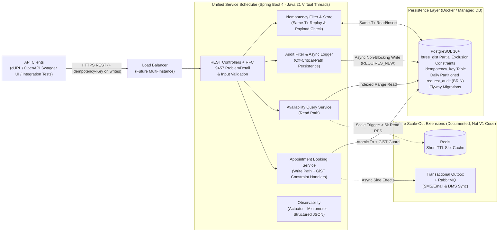
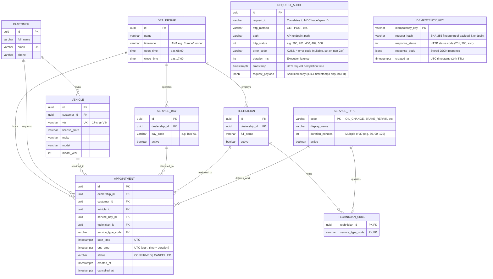
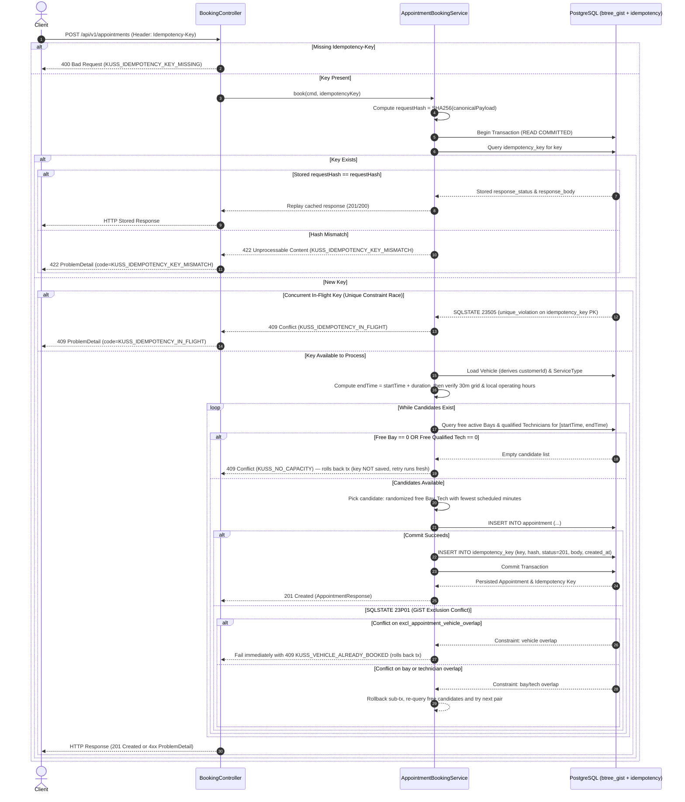

# Keyloop Unified Service Scheduler — High-Level System Design (First Draft)

> **Scenario:** Scenario A — The Unified Service Scheduler (Domain: Ownership)
> **Source Inputs:** `KeyloopCodingChallange.pdf`, `docs/brainstorm/user-draft.md`
> **Target Service Layer:** Backend (RESTful API + Persistent Database + OpenAPI / cURL Test Harness)
> **Status:** Approved by user 2026-10-30

---

## 1. Executive Summary & Design Intent

Dealership service departments traditionally coordinate appointments across spreadsheets, phone calls, and disconnected calendars—leading to double-booked bays, idle or mismatched technicians, and poor customer experience.

The **Unified Service Scheduler** replaces manual scheduling with a resource-constrained backend booking service that:
1. Accepts a service appointment request for a specific **Customer**, **Vehicle**, **ServiceType**, **Dealership**, and **desired start time**.
2. Performs a **live availability check** guaranteeing that **both** an active `ServiceBay` and a **skill-qualified** `Technician` at that dealership (plus the `Vehicle` itself) are free for the **entire service duration**.
3. Atomically persists a **`CONFIRMED` `Appointment`** record linking customer, vehicle, dealership, service bay, and technician—even under simultaneous competing requests at the exact same dealership and time.

### Assessment Calibration ("Right-Sized for Production Quality")
This design balances two evaluation goals from `KeyloopCodingChallange.pdf`:
- **Pragmatic Technical Execution:** Avoid resume-driven infrastructure bloat (unconsumed WebSockets, unnecessary message queues, two-phase payment holds where no payment exists) so the codebase stays crisp, testable, and bug-free.
- **"Build for the Future":** Guarantee database-enforced concurrency correctness, stateless horizontal scalability on Java 21 Virtual Threads, idempotent write APIs, structured observability, and explicit scale-out seams.

---

## 2. Challenging Initial Draft Assumptions (`user-draft.md` vs. Refined Design)

During brainstorming, every assumption in `docs/brainstorm/user-draft.md` was stress-tested against automotive retail reality and the Scenario A specification:

| Topic | Initial Draft (`user-draft.md`) | Critique / Engineering Tension | Agreed First-Draft Decision |
|---|---|---|---|
| **Traffic Sizing** | `500M` new bookings/month (`~193 WPS`), `20k` read / `2k` write peak RPS | `500M` bookings/month = `6B` car services/year (~4x all ~1.5B cars on Earth). Overstating scale forces unnecessary distributed infrastructure. | **Recalibrated (Agreed):** Regional Keyloop SaaS scale of **~2,000 dealerships** × ~30 bookings/day = **~60k bookings/day (~1.8M/month)**; Monday-morning surge peaks of **~1,500 read RPS / ~100 write RPS**. |
| **Latency SLA** | `<= 100ms` target (`<= 1s` max) | Achievable synchronously if we avoid extra network hops (queues/callbacks) and keep queries index-backed. | **Kept & Refined (Agreed):** **p95 `<= 100ms` reads**, **p95 `<= 200ms` writes** (`<= 1s` hard ceiling). |
| **Tech Stack Bloat** | Spring Boot 4 + Postgres + **Redis + RabbitMQ + WebSocket** | Part 2 is backend-only (no UI for WebSockets). *"Real-Time Availability Check"* in the PDF means live verification at booking time, not push streaming. Queuing writes in RabbitMQ forces async `202 Accepted` UX without speeding up the DB bottleneck. | **Trimmed Core (Agreed):** **Java 21 (Virtual Threads) + Spring Boot 4.0 + PostgreSQL + Docker** in V1 code. Stage **Redis** (read cache) and **Transactional Outbox + RabbitMQ** (async notifications/DMS sync) in the Future Scale Roadmap. |
| **Booking Lifecycle** | Two-step `PENDING` hold for `X` minutes -> `CONFIRMED` | No payment gateway exists in Scenario A. Temporary holds require TTL sweepers and create phantom unavailability when holds orphan. | **Simplified (Agreed):** **Single-step atomic `CONFIRMED` booking** (`POST /api/v1/appointments`), with `CANCELLED` transition to release capacity. |
| **Technician Capacity** | `1` technician serves up to `X = 3` appointments *simultaneously* | Reviewers reading Req 2 (*"availability of both a ServiceBay and a qualified Technician for the entire service duration"*) would flag overlapping technician assignments as a double-booking bug; `X=3` also breaks lock-free PostgreSQL GiST exclusion constraints. | **Refined (Agreed):** Strict **`1:1` exclusive allocation** (`1 bay = 1 car` and `1 technician = 1 car` for the entire duration). Parallel capacity for a `ServiceType` comes naturally from employing multiple qualified technicians at a dealership. |
| **DB Concurrency** | *"Do not lock table, use atomic conditional update"* | Plain `UPDATE ... WHERE` misses **partial interval overlaps** across variable durations (e.g., `09:00–10:30` vs. `10:00–11:00`) unless paired with discrete slot rows or PostgreSQL range exclusion constraints. | **Refined (Recommended Call):** PostgreSQL **`EXCLUDE USING gist`** range constraints on `[start_time, end_time)` + dynamic re-query retry until no free candidate pair remains (zero table locks, zero cross-time blocking). |

---

## 3. Goals, Non-Goals & Anti-Goals

### Goals
- **Zero Double-Booking Under Contention:** Guarantee at the database level that no `ServiceBay`, `Technician`, or `Vehicle` can ever hold two overlapping `CONFIRMED` appointments.
- **Full-Duration Skill & Resource Matching:** Match `ServiceType` duration (`30m` multiples) against dealership operating hours, active bays, and active technicians holding the required skill.
- **Non-Blocking High Concurrency:** Booking at Dealership A never blocks Dealership B; booking at `09:00` never blocks `14:00`; concurrent bookings at the same dealership/time resolve in milliseconds via different bay/technician pairs or fast `409 Conflict`.
- **Production-Grade Operability & Error Handling:**
  - **Agent selection:** RFC 9457 `ProblemDetail` errors (§1 line 47, §3 line 47, §5 line 145)
  - **Developer decision (after review, 2026-10-30):** Global exception handler (`@RestControllerAdvice`) mapping all exceptions to RFC 9457 `ProblemDetail` with extension fields `code` (`KUSS_*`) and `requestId`, an explicit enum catalog, and request-attribute bridging to `request_audit.error_code` — adds
  - **Reason:** Provide consistent, machine-readable, prefixed error codes across API responses, logs, and database audit records without leaking internal stack traces or database errors.
  - Required `Idempotency-Key` headers on mutating writes, Flyway schema & seed migrations, OpenAPI 3.1 contract via Springdoc, and structured logs/metrics.

### Non-Goals (Out of Scope for V1 Implementation)
- Frontend web UI (mocked/verified via OpenAPI Swagger UI, cURL scripts, and integration test suite per Part 2 Backend track).
- Authentication and authorization (OAuth2/JWT) — out of scope for the assessment test harness; seeded customer/vehicle fixtures are synthetic.
- Payment processing or multi-step checkout holds.
- Full administrative back-office CRUD for dealerships, bays, and technician rosters (seeded via Flyway; read endpoints exposed for inspection).
- Complex technician shift rosters/lunch breaks beyond dealership daily operating hours (documented as a clean extension).

### Anti-Goals (Failure Modes Even If Functional)
- Relying solely on JVM `synchronized` / `ReentrantLock` for concurrency (breaks immediately across `>1` container instances).
- Table-level locks (`LOCK TABLE`) or coarse dealership-wide locks that serialize unrelated time slots.
- Infrastructure containers in `docker-compose.yml` (e.g., idle RabbitMQ/Redis) that have no real architectural justification at target traffic.

---

## 4. Architecture & Concurrency Approaches Considered

Three concrete approaches were evaluated for modeling time and preventing race conditions across **two independent resource pools (`ServiceBay` + `Technician`)**:

### Approach A (Recommended): Continuous Time-Range Model + PostgreSQL `EXCLUDE USING gist` + Dynamic Candidate Retry
- **How it works:** Store appointments as `[start_time, end_time)` (`TIMESTAMPTZ`) in a modular-monolith Spring Boot service. Enable PostgreSQL `btree_gist` and enforce partial exclusion constraints (`WHERE status = 'CONFIRMED'`) on:
  - `(service_bay_id WITH =, tstzrange(start_time, end_time, '[)') WITH &&)`
  - `(technician_id WITH =, tstzrange(start_time, end_time, '[)') WITH &&)`
  - `(vehicle_id WITH =, tstzrange(start_time, end_time, '[)') WITH &&)`
- **Booking concurrency:** Query candidate free bays and qualified free technicians for `[start_time, end_time)`. Randomly pick among available free bays (to disperse concurrent bookings across bays) and pick the qualified technician with the fewest scheduled minutes. Attempt `INSERT INTO appointment`. If a concurrent transaction commits on the same bay/technician first, PostgreSQL raises SQLSTATE `23P01` (`exclusion_violation`). Because PostgreSQL serializes index inserts, the losing transaction's `23P01` occurs only after the winning transaction commits; thus, an immediate re-query of free candidates sees the committed booking, naturally prunes that taken resource, and retries the next candidate pair until no free pairs remain. `409 Conflict (NO_CAPACITY)` is returned strictly when capacity is genuinely exhausted.
- **Pros:**
  - **Database-guaranteed overlap prevention:** Hard schema-level invariant enforced by PostgreSQL GiST constraints (while skill qualification and dealership scoping are enforced at the application service layer).
  - **Zero extra locking layers:** Eliminates advisory locks, complex 64-bit key hashing, and pre-generated slot tables.
  - **Guaranteed termination without false `409`s:** Retries terminate in at most $K$ attempts (where $K$ is the number of free candidate pairs at that time).
  - **Minimal schema & operational footprint:** No background cron jobs to pre-generate millions of empty slot rows.
- **Cons:**
  - Requires PostgreSQL (`btree_gist` extension)—cannot swap to an H2 in-memory test DB (mitigated cleanly by **Testcontainers PostgreSQL**, which is best practice anyway).
  - In theory, $N$ simultaneous requests contending for 1 slot take up to $O(N^2)$ candidate attempts worst-case; at realistic workshop scale ($N \approx 5\text{--}10$ bays per dealership), contention resolves in a few milliseconds.

### Approach B: Pre-Materialized Discrete 30-Minute Slot Grid + `FOR UPDATE` / Conditional `UPDATE`
- **How it works:** Pre-populate `service_bay_slot` and `technician_slot` tables with one row per 30-minute block per resource for the next 90 days. A 90-minute appointment claims 3 contiguous `bay_slot` rows and 3 contiguous `technician_slot` rows via deterministic row-level locking (`SELECT ... FOR UPDATE`) or conditional `UPDATE ... WHERE appointment_id IS NULL` (verifying `updatedRows == requiredSlots`).
- **Pros:**
  - Matches a traditional discrete-grid mental model; simple integer/equality indexing without GiST ranges.
  - Deterministic pessimistic lock ordering (`bay_id ASC, slot_start ASC`, then `tech_id ASC, slot_start ASC`) avoids optimistic retries.
- **Cons:**
  - **Severe data bloat & operational lifecycle overhead:** `2,000 dealerships × 40 resources × 18 slots/day × 90 days ≈ 130M rows` mostly sitting empty, requiring scheduled rolling-window generator jobs.
  - Changing dealership operating hours or slot granularity (`30m` -> `15m`) requires migrating/regenerating pre-built slot rows.
  - `SKIP LOCKED` is awkward across multi-slot spans (if `09:00` is free and `09:30` is locked by another thread, partial `SKIP LOCKED` yields incomplete spans unless carefully grouped).

### Approach C: Distributed Lock / Redis Hold + Async Queue (RabbitMQ + WebSocket)
- **How it works:** Acquire short-lived keys in Redis (`SET NX PX`) per resource/slot, enqueue booking commands in RabbitMQ, persist asynchronously to PostgreSQL, and push confirmation over WebSocket.
- **Pros:**
  - Absorbs extreme global flash-crowd spikes (e.g., stadium concert ticketing).
- **Cons:**
  - **Wrong trade-off for Scenario A:** Breaks synchronous REST confirmation UX (`202 Accepted` instead of immediate `201 Created` / `409 Conflict`), introduces distributed-state drift if Redis lock TTL expires mid-GC pause, and adds heavy operational complexity with zero gain at automotive dealership traffic.

### Recommendation & Decision
**Approach A approved** by developer decision (2026-10-30). It showcases deep PostgreSQL knowledge (`btree_gist` range exclusion), keeps the architecture lean on Java 21 Virtual Threads, avoids millions of synthetic slot rows, and proves correctness with concurrent Testcontainers integration tests.

---

## 5. High-Level Architecture & Component Roles



### Component Breakdown
| Component | Responsibility |
|---|---|
| **REST API, Global Exception Handler & Validation Layer** | Validates request DTOs and 30-min slot boundaries; maps all service and domain exceptions via a single `@RestControllerAdvice` into RFC 9457 `ProblemDetail` with extension fields `code` (`KUSS_*`) and `requestId`; sets request attribute `kuss_error_code` for audit filter correlation; returns 500 `KUSS_INTERNAL_ERROR` for unhandled exceptions without leaking stack traces or SQL. |
| **Idempotency Layer** | Enforces required `Idempotency-Key` header on write endpoints (`POST /appointments`, cancel); checks for duplicate requests in `idempotency_key` table within the same transaction; returns cached response on match, `422` (`KUSS_IDEMPOTENCY_KEY_MISMATCH`) on payload hash mismatch, or `409` (`KUSS_IDEMPOTENCY_IN_FLIGHT`) on in-flight conflict. |
| **Audit Filter & Async Logger** | Captures all incoming HTTP requests (reads included) and metadata; captures `KUSS_*` error code from request attribute on non-2xx responses; dispatches non-blocking persistence in an isolated transaction (`REQUIRES_NEW`) off the HTTP response critical path without failing requests on write errors. |
| **Availability Query Service** | Computes bookable 30-minute start times for `(dealershipId, date, serviceType)` within dealership local operating hours using a compact indexed read + in-memory interval sweep. |
| **Appointment Booking Service** | Executes atomic single-step booking (`CONFIRMED`) and cancellation (`CANCELLED`), coordinating candidate `(ServiceBay, Technician)` selection, skill verification, and specific GiST constraint error handling. |
| **PostgreSQL 16+ (`btree_gist`)** | System of record enforcing relational integrity, hard non-overlapping time-range constraints on bays, technicians, and vehicles, and storing partitioned request audit records with BRIN indexing. |
| **Observability Module** | Spring Boot Actuator, Micrometer Prometheus metrics, structured JSON logging with MDC `traceId`/`spanId`. |

---

## 6. Domain Model & Database Design



### Critical Database Constraints & Indexes
1. **Extension:** `CREATE EXTENSION IF NOT EXISTS btree_gist;`
2. **Half-Open Interval Convention (`[start_time, end_time)`):** Using `[)` bounds allows back-to-back appointments without false collisions (`09:00–10:00` followed immediately by `10:00–11:00`).
3. **Three Partial GiST Exclusion Constraints (`WHERE status = 'CONFIRMED'`):**
   - `excl_appointment_bay_overlap`: `EXCLUDE USING gist (service_bay_id WITH =, tstzrange(start_time, end_time, '[)') WITH &&) WHERE (status = 'CONFIRMED')`
   - `excl_appointment_tech_overlap`: `EXCLUDE USING gist (technician_id WITH =, tstzrange(start_time, end_time, '[)') WITH &&) WHERE (status = 'CONFIRMED')`
   - `excl_appointment_vehicle_overlap`: `EXCLUDE USING gist (vehicle_id WITH =, tstzrange(start_time, end_time, '[)') WITH &&) WHERE (status = 'CONFIRMED')`
   - *(Note: Partial `WHERE (status = 'CONFIRMED')` means cancelling an appointment immediately frees that time window for re-booking while preserving audit history).*
   - **Agent selection:** `excl_appointment_vehicle_overlap` acts as natural double-submit deduplication without requiring a separate idempotency key table (C-011 #2 / A-012)
   - **Developer decision (after review, 2026-10-30):** Use an `Idempotency-Key` header and dedicated `idempotency_key` table on mutating requests (`POST /appointments` and cancel) — overrides
   - **Reason:** Guarantee that retrying a booking or cancel request after a client-side timeout or transient network failure never produces duplicate side-effects, replaying the stored response for identical payloads while rejecting mismatches with `422` and in-flight conflicts with `409` (vehicle-overlap `EXCLUDE` remains the second line of defense).
4. **App-Level Scoping & Qualification:** While PostgreSQL guarantees zero time-overlap on bays, technicians, and vehicles, qualification (`technician_skill`) and dealership tenancy (verifying the assigned bay and technician belong to `dealership_id`) are validated explicitly in the application service layer.
5. **Read Path Index:** Composite index on `appointment (dealership_id, start_time, end_time) WHERE status = 'CONFIRMED'` so full-day dealership schedule reads touch `< 100` rows (latency to be validated in integration/concurrency tests).
6. **Request Audit Partitioning & BRIN Indexing:**
   - **Agent selection:** none (not in the draft)
   - **Developer decision (after review, 2026-10-30):** Add dedicated `request_audit` table partitioned daily with BRIN index and 14-day rolling retention — adds
   - **Reason:** Provide request auditing for incident investigation across all API endpoints without blocking request execution.
   - **Developer decision (after review, 2026-10-31):** every schema change goes through Flyway versioned migrations (tracked in flyway_schema_history); Hibernate ddl-auto=validate with generate-ddl=false, so Hibernate never changes tables; a committed migration is never edited. The only DDL outside Flyway is the runtime maintenance job creating and dropping request_audit day partitions (data lifecycle, like pg_partman); it never alters columns, indexes or constraints — adds. Reason: one auditable source of schema history; daily partitions cannot be versioned migrations.
   - **Partition Management & Sizing:**
     - Table `request_audit` is partitioned by day (`PARTITION BY RANGE (timestamp)`).
     - A `DEFAULT` partition (`CREATE TABLE request_audit_default PARTITION OF request_audit DEFAULT;`) acts as a safety net ensuring writes succeed even if future partitions are delayed.
     - A simple Spring Boot `@Scheduled` maintenance task (no `pg_partman` dependency) runs daily to:
       1. Pre-create daily partitions for the upcoming rolling window (`D+1` to `D+7`).
       2. Drop partitions older than 14 days in $O(1)$ time via `DROP TABLE`, eliminating table bloat and vacuum churn.
     - `CREATE INDEX idx_request_audit_timestamp_brin ON request_audit USING brin (timestamp);` — minimal RAM/disk footprint for sequential appends.
     - `CREATE INDEX idx_request_audit_request_id ON request_audit (request_id);` — fast B-tree point lookups by request identifier.
7. **Idempotency Key Store & Lifecycle:**
   - Table `idempotency_key` (`idempotency_key PK`, `request_hash`, `response_status`, `response_body`, `created_at`).
   - Co-located in the same transaction as the booking/cancel mutation: commits or rolls back atomically.
   - 24-hour expiration managed by a simple scheduled cleanup (`DELETE FROM idempotency_key WHERE created_at < now() - INTERVAL '24 hours'`).

---

## 7. Data Flows & Core Algorithms

### 7.1 Read Flow: Real-Time Availability Check (`GET` Available Slots)
1. **Input:** `dealershipId`, `date` (`YYYY-MM-DD` in dealership local date), `serviceType`.
2. **Window Resolution:** Load `Dealership` (`timezone`, `open_time`, `close_time`) and `ServiceType` (`duration_minutes`). Compute `[dayOpenUtc, dayCloseUtc)` in UTC.
3. **Compact Data Fetch (3 tiny indexed queries or 1 combined read):**
   - Active `ServiceBay` IDs at `dealershipId` (`B` bays).
   - Active `Technician` IDs at `dealershipId` holding skill `serviceType` (`T` technicians). If `B == 0` or `T == 0`, return empty slots immediately.
   - All `CONFIRMED` appointments at `dealershipId` where `start_time < dayCloseUtc AND end_time > dayOpenUtc`.
4. **In-Memory 30-Minute Grid Sweep:**
   - Generate candidate start times `s` in 30-minute steps from `open_time` where `s + duration <= close_time` (filtering out past slots if `date` is today).
   - For each `s`, let `window = [s, s + duration)`:
     - `freeBays = count(bay in B where no confirmed appointment on bay overlaps window)`
     - `freeTechs = count(tech in T where no confirmed appointment on tech overlaps window)`
     - `availableCapacity = min(freeBays, freeTechs)`
     - Include slot if `availableCapacity >= 1`.
5. **Performance:** For a typical dealership (`20` bays, `25` techs, `60` daily bookings, `18` daily 30-min slots), this executes with a single compact query and in-memory sweep with zero N+1 SQL queries (latency to be measured in integration tests).

### 7.2 Write Flow: Resource-Constrained Booking (`POST /api/v1/appointments`)



- **Idempotency Execution Location Relative to GiST Retry Loop:**
  - Idempotency validation runs **at the entry of the booking transaction**.
  - If a stored record matches the key and payload hash, the response is returned immediately without entering the GiST availability query or candidate loop.
  - The `idempotency_key` row is inserted **in the same database transaction** as the `appointment`. If the booking succeeds, both commit together. If booking fails with `409 KUSS_NO_CAPACITY` or `500 KUSS_INTERNAL_ERROR`, the transaction rolls back completely—leaving no key row behind so that a subsequent client retry runs completely fresh.
- **Candidate Selection & Collision Dispersion:** Disperse concurrent bookings across available bays by randomizing bay selection among current free bays, and pick the qualified technician with the fewest confirmed minutes scheduled on that date to balance workload.
- **Specific Constraint Handling on SQLSTATE `23P01` *(Claude Code cross-review refinement)*:** When an exclusion conflict occurs, inspect `PSQLException.getServerErrorMessage().getConstraint()`. If `excl_appointment_vehicle_overlap` fires, immediately abort with `409 KUSS_VEHICLE_ALREADY_BOOKED` without wasting retries. If bay or technician overlap fires, the transaction rolls back; the immediate re-query sees the winner's committed appointment, excludes that taken resource, and attempts the next candidate until genuine capacity is exhausted.

### 7.3 Cancellation Flow (`POST /api/v1/appointments/{id}/cancel`)
- Requires `Idempotency-Key` header (missing -> `400 Bad Request` with `code: KUSS_IDEMPOTENCY_KEY_MISSING`).
- In the same transaction:
  - Validates `idempotency_key`: identical key + payload returns stored response; key reuse with mismatched path/body returns `422` (`KUSS_IDEMPOTENCY_KEY_MISMATCH`); in-flight race returns `409` (`KUSS_IDEMPOTENCY_IN_FLIGHT`).
  - Verifies appointment exists (`404` with `KUSS_RESOURCE_NOT_FOUND` if absent).
  - Checks appointment start time: if appointment is already in the past, returns `409 Conflict` with cancel-specific code `KUSS_APPOINTMENT_ALREADY_STARTED`.
  - Executes atomic update: `UPDATE appointment SET status = 'CANCELLED', cancelled_at = now() WHERE id = ? AND status = 'CONFIRMED'`. If already cancelled, returns idempotent cached `200 OK`.
  - Records response in `idempotency_key` and commits atomically.
- Because GiST exclusion constraints are partial (`WHERE status = 'CONFIRMED'`), both the `ServiceBay` and `Technician` immediately become bookable again.

### 7.4 Request Auditing Flow
- **Agent selection:** none (not in the draft)
- **Developer decision (after review, 2026-10-30):** Full request auditing (reads included, off-critical-path async write, `REQUIRES_NEW`, daily partitioning + BRIN) — adds
- **Reason:** Provide request auditing for incident investigation across all API endpoints without blocking request execution.
- **Execution Lifecycle:**
  1. **Scope:** Every incoming API request (including `GET` availability reads and failed `4xx`/`500` calls) is captured.
     - **Developer decision (after review, 2026-10-31):** audit scope "/api/**" becomes "all paths except actuator and API docs" (matched on the normalized servlet path) — overrides. Reason: red-team finding #10.
  2. **Ingress & Correlation:** `AuditLoggingFilter` assigns a unique `requestId` (UUID), injects it into MDC logging context and the `X-Request-Id` response header, notes `startTime = Instant.now()`, and caches the sanitized JSON request body (structural IDs/timestamps only; no PII).
  3. **Execution & Non-Blocking Completion:** The HTTP request executes normally. Upon response completion (in a `finally` block), the filter records `httpStatus`, extracts the `KUSS_*` error code (populated via request attribute set by `@RestControllerAdvice` on non-2xx; `null` on success), and computes `durationMs`.
  4. **Off-Critical-Path Persistence:** The filter dispatches the audit event asynchronously (using Java 21 Virtual Threads) so the HTTP response is flushed to the client immediately without waiting for DB audit I/O.
  5. **Fault-Tolerant Independent Transaction:** An `AsyncAuditService` writes to `request_audit` in its own transaction (`Propagation.REQUIRES_NEW`), guaranteeing:
     - Rolled-back business transactions (`409 Conflict`, `500 Internal Server Error`) are still reliably audited with their exact `KUSS_*` error code.
     - Any audit write failure is caught, logged at `WARN` with the `requestId`, and discarded; it **never** fails the client's HTTP response.

---

## 8. REST API Surface *(Proposed Defaults — Confirming Scope)*

> *Note: Master data (`Dealership`, `ServiceBay`, `Technician` + `TechnicianSkill`, `ServiceType`, and sample `Customer`/`Vehicle` records) is pre-seeded via Flyway migrations so reviewers can test immediately after `docker compose up` without admin CRUD boilerplate.*

| Method & Path | Purpose | Key Inputs | Success / Error Codes |
|---|---|---|---|
| `GET /api/v1/dealerships` | List dealerships & operating hours | — | `200 OK` |
| `GET /api/v1/dealerships/{dealershipId}` | Inspect dealership details, active bays & technicians | Path `dealershipId` | `200 OK`, `404 Not Found` |
| `GET /api/v1/service-types` | List service catalog & durations | — | `200 OK` |
| `GET /api/v1/customers` | List seeded customers & vehicles (for test harness/discovery)<br/>- **Developer decision (after review, 2026-10-31):** vehicles are returned as id, make, model, modelYear only (no VIN, no plate) — overrides. Reason: red-team finding #10. | — | `200 OK` |
| `GET /api/v1/dealerships/{dealershipId}/availability` | Check bookable 30-min start slots | `?date=2026-11-02&serviceType=BRAKE_REPAIR` | `200 OK`, `400 Bad Request`, `404 Not Found` |
| `GET /api/v1/dealerships/{dealershipId}/appointments` | Inspect confirmed & cancelled appointments for date | `?date=2026-11-02` | `200 OK`, `400 Bad Request`, `404 Not Found` |
| `POST /api/v1/appointments` | Request & atomically confirm booking | Header: `Idempotency-Key` (REQUIRED)<br>Body: `{ dealershipId, vehicleId, serviceTypeCode, desiredStartTime }` (Customer derived from `Vehicle`) | `201 Created` (or replayed `201/200`), `400 Bad Request` (missing `Idempotency-Key`, invalid grid/hours/past date), `404 Not Found`, `409 Conflict` (in-flight same key, or no capacity/vehicle overlap), `422 Unprocessable Content` (idempotency payload mismatch) |
| `GET /api/v1/appointments/{appointmentId}` | Fetch confirmed/cancelled appointment details | Path `appointmentId` | `200 OK`, `404 Not Found` (`KUSS_RESOURCE_NOT_FOUND`) |
| `POST /api/v1/appointments/{appointmentId}/cancel` | Cancel appointment & free bay + technician | Header: `Idempotency-Key` (REQUIRED)<br>Path: `appointmentId` | `200 OK` (or replayed `200`), `400 Bad Request` (`KUSS_IDEMPOTENCY_KEY_MISSING`), `404 Not Found` (`KUSS_RESOURCE_NOT_FOUND`), `409 Conflict` (`KUSS_IDEMPOTENCY_IN_FLIGHT` or `KUSS_APPOINTMENT_ALREADY_STARTED`), `422 Unprocessable Content` (`KUSS_IDEMPOTENCY_KEY_MISMATCH`) |

### 8.1 Error Response Specification & Catalog (RFC 9457 + KUSS_* Extensions)
- **Agent selection:** RFC 9457 ProblemDetail errors (§1 line 47, §3 line 47, §5 line 145) with no error-code catalog and no global handler
- **Developer decision (after review, 2026-10-30):** Single `@RestControllerAdvice` global exception handler mapping all exceptions to RFC 9457 `ProblemDetail` with extension fields `code` (`KUSS_*`) and `requestId` (correlated with MDC, `X-Request-Id`, and `request_audit`), driven by an explicit enum catalog — adds
- **Reason:** Guarantee a standardized machine-readable error catalog across all API responses, application logs, and database audit records without leaking internal details.

#### ProblemDetail Format
All non-2xx responses return `Content-Type: application/problem+json` with two explicit extension fields:
```json
{
  "type": "about:blank",
  "title": "Conflict",
  "status": 409,
  "detail": "No service bay and qualified technician pair is available for the requested duration.",
  "instance": "/api/v1/appointments",
  "code": "KUSS_NO_CAPACITY",
  "requestId": "c1f7a402-9a3b-4c28-98e3-0d3f27a69bc1"
}
```
*(Information Hygiene: Stack traces, internal Java class names, and raw SQL/PSQLException messages are never leaked in `detail`.)*

#### KUSS_* Error Code Catalog (Enum `ErrorCode`)
| Error Code | HTTP Status | Trigger Condition |
|---|---|---|
| `KUSS_VALIDATION_FAILED` | `400 Bad Request` | Request DTO validation failure (e.g. malformed JSON, desired start time not aligned to `:00` or `:30`, start time in the past, or booking exceeds dealership operating hours). |
| `KUSS_IDEMPOTENCY_KEY_MISSING` | `400 Bad Request` | Missing `Idempotency-Key` header on write endpoints (`POST /api/v1/appointments` or cancel). |
| `KUSS_RESOURCE_NOT_FOUND` | `404 Not Found` | Target entity not found (e.g. unknown `dealershipId`, `vehicleId`, `serviceTypeCode`, or `appointmentId`). |
| `KUSS_VEHICLE_ALREADY_BOOKED` | `409 Conflict` | Vehicle GiST exclusion violation (`excl_appointment_vehicle_overlap` SQLSTATE `23P01`). The vehicle already holds an active booking overlapping the requested window. |
| `KUSS_NO_CAPACITY` | `409 Conflict` | Candidate evaluation and dynamic retry loop exhausted; no free `ServiceBay` and qualified `Technician` pair available for the entire duration. |
| `KUSS_IDEMPOTENCY_IN_FLIGHT` | `409 Conflict` | A concurrent request with the exact same `Idempotency-Key` is currently executing in an uncommitted transaction (caught via PK constraint). |
| `KUSS_APPOINTMENT_ALREADY_STARTED` | `409 Conflict` | Cancellation attempted on an appointment whose start time has already passed. |
| `KUSS_IDEMPOTENCY_KEY_MISMATCH` | `422 Unprocessable Content` | An `Idempotency-Key` was re-submitted with a different payload hash than originally recorded. |
| `KUSS_INTERNAL_ERROR` | `500 Internal Server Error` | Unhandled runtime exception or infrastructure failure. Stack trace logged internally at `ERROR` with `requestId`; sanitized generic message returned to client. |

---

## 9. Observability Strategy

Designed to satisfy Keyloop's explicit observability criteria across the three pillars without requiring external paid SaaS to run locally:

1. **Structured Logging:**
   - JSON structured logs in `prod` profile (human-readable console in `local` profile) via Spring Boot 4 native structured logging.
   - Automatic MDC injection of `traceId`, `spanId`, and `requestId` via Micrometer Tracing + contextual fields (`dealershipId`, `serviceTypeCode`, `appointmentId`, `retryAttempt`, and `kuss_error_code` on failures).
   - PII hygiene: never log customer email, phone, or full name at `INFO`/`WARN`.
2. **Metrics (Spring Boot Actuator + Micrometer -> Prometheus):**
   - Standard JVM, HikariCP pool saturation (`hikaricp.connections.pending` / `active`), and HTTP server latency histograms (`p50`, `p95`, `p99`).
   - **Domain Metrics (Bounded Cardinality):**
     - `scheduler.booking.requests_total{service_type, result="confirmed|KUSS_NO_CAPACITY|KUSS_VEHICLE_ALREADY_BOOKED|KUSS_VALIDATION_FAILED|KUSS_IDEMPOTENCY_KEY_MISSING|KUSS_INTERNAL_ERROR"}` — using the `KUSS_*` error code as the result tag ensures cheap, bounded cardinality while aligning metrics directly with the error catalog!
     - `scheduler.booking.gist_retries_total{conflict_type="bay|technician"}` — bounded cardinality counter measuring write contention without leaking dealership IDs!
     - `scheduler.availability.query.duration` timer.
3. **Distributed Tracing:**
   - Micrometer Tracing populating `traceId`/`spanId` in logs; full OpenTelemetry OTLP bridge export documented as a seamless future extension.
4. **Operational Health:**
   - `/actuator/health/liveness` and `/actuator/health/readiness` verifying PostgreSQL pool health.
5. **Request Auditing & Incident Triage:**
   - **Agent selection:** none (not in the draft)
   - **Developer decision (after review, 2026-10-30):** Full request auditing with MDC correlation and audit write telemetry — adds
   - **Reason:** Provide request auditing for incident investigation across all API endpoints without blocking request execution.
   - Persistent `request_audit` table captures 100% of API invocations (reads, 409s, and 500s included) with `request_id`, HTTP method, path, status, `KUSS_*` error code (via request attribute bridge; `null` on 2xx), duration, timestamp, and sanitized payload JSONB (zero PII).
   - Unified `request_id` correlation: matches MDC `traceId`/`requestId` across structured application logs, enabling seamless jump from log alerts to complete request audit history during post-incident investigations.
   - Audit telemetry: `scheduler.audit.writes_total{status="success|failure"}` tracks asynchronous audit persistence health.

---

## 10. "Build for the Future" — Scalability & Evolution Roadmap

While V1 stays intentionally lean for reliability and clarity, the architecture separates read/write paths and keeps app instances 100% stateless so each bottleneck has a clean upgrade path:

| Growth Trigger | Bottleneck | Planned Evolution (Zero Core Domain Rewrite) |
|---|---|---|
| **> 5,000–20,000 Read RPS** (e.g., OEM-wide recall campaign traffic) | Repeated availability reads on popular dealerships | Add **Redis Cache-Aside** keyed by `avail:{dealershipId}:{date}:{serviceType}` (`TTL = 10s`) with explicit eviction on `AppointmentBooked`/`AppointmentCancelled` domain events, plus **PostgreSQL Read Replicas**. Redis remains *advisory*; PostgreSQL GiST constraints remain the write source of truth. |
| **Multi-Year Data Growth** (`> 50M` historical appointments) | GiST & B-Tree index size on `appointment` | Move historical/completed rows (`> 90` days old) to cold archive storage or partition active vs. historical tables, keeping the active `WHERE status = 'CONFIRMED'` partial GiST index tiny in RAM. |
| **Downstream Side Effects** (SMS/Email confirmations, Dealer Management System sync) | Synchronous external HTTP calls would break `<= 200ms` write SLA & reliability | Introduce **Transactional Outbox table** written in the same PostgreSQL transaction as `Appointment`, relayed asynchronously to **RabbitMQ / Kafka** consumers. |
| **Richer Workshop Constraints** | EV high-voltage bays, heavy-truck lifts, technician shift calendars & breaks | Add `bay_capability` join table (mirroring `technician_skill`) and `technician_unavailability` / `shift` intervals using the exact same `[start, end)` range model. |
| **Client Authentication or Partner Integrations** | Request tampering, non-repudiation, and replay attacks across public or partner networks without mutual TLS | Introduce **Keyed Request Signing** (HMAC-SHA256 over method + path + timestamp + SHA-256(body) with per-client secret, or RFC 9421 HTTP Message Signatures) enforced with timestamp-window replay protection (e.g. 5-minute validity). |

---

## 11. Documented Assumptions & Ambiguity Log

Per `KeyloopCodingChallange.pdf` (*"A Note on Ambiguity"*), the following explicit assumptions govern V1:

1. **Exclusive `1:1` Resource Usage:** Each appointment requires exactly **1 `ServiceBay`** and **1 qualified `Technician`** exclusively for the entire `[startTime, endTime)` service duration (`1 bay = 1 car`, `1 tech = 1 car`).
2. **General-Purpose Bays, Specialized Technicians:** All active `ServiceBay`s at a dealership are interchangeable in V1, whereas `Technician`s only qualify for appointments matching one of their assigned `ServiceType` skills.
3. **Auto-Assignment:** Customers choose dealership, service type, vehicle, and start time; the system automatically assigns an available bay and qualified technician rather than exposing internal workshop bay numbers to end users.
4. **30-Minute Alignment & Fixed Service Durations:** Requested start times must align to `:00` or `:30` boundaries in the dealership's local timezone, and `ServiceType` durations are fixed multiples of 30 minutes (`30m, 60m, 90m, 120m`).
5. **Single-Day Operating Hours:** The entire `[startTime, endTime)` interval must fall within the dealership's `[open_time, close_time]` on that local calendar date (no overnight multi-day jobs in V1) and must be in the future at booking time.
6. **Same-Vehicle Overlap Prohibition:** A physical `Vehicle` cannot hold two overlapping `CONFIRMED` appointments, even at different dealerships.
7. **Single-Step Confirmation (No Payment Hold):** Bookings confirm immediately upon availability verification; no payment gateway or temporary `PENDING` hold TTL exists in V1.
8. **Pre-Seeded Catalog & Roster:** Dealerships, bays, technicians, skills, service types, and test customers/vehicles are seeded via Flyway migrations rather than managed through administrative CRUD APIs.
9. **No Authentication / Authorization in V1:** In accordance with the challenge scope, API endpoints do not require authentication tokens; customer and vehicle discovery endpoints exist to supply valid test identifiers for the API harness.
   - **Developer decision (after review, 2026-10-31):** anyone can read all data and cancel any appointment; auth and per-dealership scoping are roadmap; there is no rate limiting — overrides. Reason: red-team finding #10.
10. **Comprehensive Request Auditing:**
    - **Agent selection:** none (not in the draft)
    - **Developer decision (after review, 2026-10-30):** Every API request (reads included) is audited asynchronously into a daily-partitioned `request_audit` table with BRIN timestamp indexing and a rolling 14-day retention window — adds
    - **Reason:** Guarantee complete auditability for post-incident triage without blocking API request latency.
11. **Idempotency on Mutating Endpoints:**
    - **Agent selection:** no Idempotency-Key; a duplicate POST gets 409 from the vehicle EXCLUDE constraint (C-011 #2 / A-012)
    - **Developer decision (after review, 2026-10-30):** Required `Idempotency-Key` on writes (`POST /appointments` and cancel) with transactional `idempotency_key` table, 24h retention, replaying stored responses, returning 422 on payload mismatch, and 409 on concurrent in-flight requests — overrides
    - **Reason:** Prevent duplicate appointments and duplicate state mutations across client-side network timeouts and retries while preserving fresh retryability on rolled-back failures.

---

## 12. Summary of Decisions: User-Agreed vs. Antigravity's Proposed Calls

To make review effortless, here is what we explicitly agreed in chat versus defaults filled in for this first draft, along with developer review decisions:

### Core Architecture & Domain Foundations (Agreed)
- Target realistic automotive SaaS traffic (~2k dealerships, ~1.8M bookings/mo, peak ~1,500 read / ~100 write RPS, `<=100ms` read p95) appropriate for a strong 2–4 YoE submission.
- Core stack: **Java 21 (Virtual Threads) + Spring Boot 4.0 + PostgreSQL + Docker**; cut WebSocket and `PENDING` holds; move Redis and Outbox + RabbitMQ to the Future Scale Roadmap.
- Strict `1:1` exclusive bay & technician allocation for the full duration; multi-skill technicians + general-purpose bays; auto-assignment; vehicle overlap prevention; 30-minute time grid within dealership local operating hours.

### Concurrency Control (Approach A)
- **Agent selection:** Approach A (PostgreSQL `btree_gist` partial `EXCLUDE USING gist` constraints on `[start_time, end_time)` + dynamic re-query retry until capacity exhaustion, with randomized bay selection to disperse contention; C-008 / A-012).
- **Developer decision (after review, 2026-10-30):** Approach A approved — confirms
- **Reason:** Database-level GiST exclusion constraints enforce non-overlapping resource invariants with zero table locks or synthetic slot rows.

### Idempotency Control
- **Agent selection:** no Idempotency-Key; a duplicate POST gets 409 from the vehicle EXCLUDE constraint (C-011 #2 / A-012)
- **Developer decision (after review, 2026-10-30):** Required `Idempotency-Key` on writes (`POST /appointments` and cancel) persisted in the same transaction via `idempotency_key` table with 24h cleanup, replaying stored responses, returning 422 on payload mismatch, and 409 on concurrent in-flight requests — overrides
- **Reason:** Guarantee that retrying a booking or cancel request after a client-side timeout or transient failure never produces duplicate data or unexpected errors, replaying the stored response for identical payloads while rejecting mismatches with `422` and in-flight conflicts with `409`.

### Request Auditing Table
- **Agent selection:** none (not in the draft)
- **Developer decision (after review, 2026-10-30):** Add dedicated `request_audit` table partitioned daily with BRIN index, 14-day rolling retention, and off-critical-path async write — adds
- **Reason:** Provide request auditing for incident investigation across all API endpoints without blocking request execution.
- **Developer decision (after review, 2026-10-31):** audit scope "/api/**" becomes "all paths except actuator and API docs" (matched on the normalized servlet path) — overrides. Reason: red-team finding #10.
- **Developer decision (after review, 2026-10-31):** every schema change goes through Flyway versioned migrations (tracked in flyway_schema_history); Hibernate ddl-auto=validate with generate-ddl=false, so Hibernate never changes tables; a committed migration is never edited. The only DDL outside Flyway is the runtime maintenance job creating and dropping request_audit day partitions (data lifecycle, like pg_partman); it never alters columns, indexes or constraints — adds. Reason: one auditable source of schema history; daily partitions cannot be versioned migrations.

### Error Handling & Prefixed Error Codes (KUSS_*)
- **Agent selection:** RFC 9457 ProblemDetail errors (§1 line 47, §3 line 47, §5 line 145) with no error-code catalog and no global handler
- **Developer decision (after review, 2026-10-30):** Single `@RestControllerAdvice` global exception handler mapping all exceptions to RFC 9457 `ProblemDetail` with extension fields `code` (`KUSS_*`) and `requestId` (correlated with MDC, `X-Request-Id`, and `request_audit`), driven by an explicit enum catalog — adds
- **Reason:** Guarantee a standardized machine-readable error catalog across all API responses, application logs, and database audit records without leaking internal details.

### Request-Body Integrity & Request Signing (Roadmap Only)
- **Agent selection:** none (not in the draft)
- **Developer decision (after review, 2026-10-30):** request signing is deferred to the Future Scale Roadmap, alongside client authentication — adds (roadmap)
- **Reason:** a plain unkeyed SHA-256 header gives no tamper protection, because anyone who can modify the body can recompute the hash. TLS already gives in-flight integrity. Overlapping bookings are already blocked by the EXCLUDE constraints, and a retry with a changed body is already rejected by the server-computed idempotency_key.request_hash (422 KUSS_IDEMPOTENCY_KEY_MISMATCH). Real tamper and replay protection needs a keyed signature: HMAC over method + path + timestamp + SHA-256(body) with a per-client secret, or HTTP Message Signatures (RFC 9421), which belongs with an auth story.

### API Payload & Customer Derivation (C-011 #3)
- **Agent selection:** Minimal `POST /api/v1/appointments` request payload `{ dealershipId, vehicleId, serviceTypeCode, desiredStartTime }`, deriving `customerId` from `vehicle.customer_id` (C-006 / C-011 #3 / A-010).
- **Developer decision (after review, 2026-10-30):** Minimal POST body with customer derived from vehicle confirmed — confirms
- **Reason:** Keeps the API contract clean and eliminates client-side customer-vehicle disagreement errors.

### Endpoint Scope (C-011 #4)
- **Agent selection:** Extra read/discovery endpoints (`GET /dealerships`, `GET /dealerships/{id}`, `GET /service-types`, `GET /customers`, `GET .../availability`, `GET .../appointments?date=...`) and cancel endpoint beyond the 3 PDF requirements (C-006 / C-011 #4 / A-010).
- **Developer decision (after review, 2026-10-30):** Extra read/discovery endpoints and cancel endpoint approved — confirms
- **Reason:** Enables seamless inspection, Swagger UI testing, and appointment lifecycle cancellation without full admin CRUD overhead.

### Technician Selection Heuristic (C-011 #5)
- **Agent selection:** Technician pick = fewest scheduled minutes that day (C-008 / C-011 #5 / A-010).
- **Developer decision (after review, 2026-10-30):** Technician workload-balancing selection rule approved — confirms
- **Reason:** Distributes scheduled workload fairly across qualified technicians at the dealership on that date.

### Additional Specifications & Test Coverage Requirements
- **Security & Scope:** No AuthN/AuthZ in V1; synthetic fixtures seeded for demonstration.
- **Mandatory Test Scenarios (One per Critical Code Path):**
  1. **Validation Failure (400):** Non-30m slot alignment, past date, or outside operating hours returns `400` with `code: KUSS_VALIDATION_FAILED`.
  2. **Missing Idempotency Key (400):** Write request lacking `Idempotency-Key` returns `400` with `code: KUSS_IDEMPOTENCY_KEY_MISSING`.
  3. **Entity Not Found (404):** Non-existent dealership, vehicle, or appointment returns `404` with `code: KUSS_RESOURCE_NOT_FOUND`.
  4. **Vehicle Double-Booking (409):** Concurrent or repeated booking on the same vehicle returns `409` with `code: KUSS_VEHICLE_ALREADY_BOOKED`.
  5. **Capacity Exhaustion (409):** Booking when all bays or qualified technicians are occupied returns `409` with `code: KUSS_NO_CAPACITY`.
  6. **Concurrent In-Flight Key (409):** Simultaneous requests with the same `Idempotency-Key` return `409` with `code: KUSS_IDEMPOTENCY_IN_FLIGHT` for the loser.
  7. **Past Cancellation Conflict (409):** Attempting to cancel an appointment whose start time has passed returns `409` with `code: KUSS_APPOINTMENT_ALREADY_STARTED`.
  8. **Idempotency Payload Mismatch (422):** Reusing an `Idempotency-Key` with altered payload hash returns `422` with `code: KUSS_IDEMPOTENCY_KEY_MISMATCH`.
  9. **Internal Error Sanitization (500):** Unhandled exceptions map to `500` with `code: KUSS_INTERNAL_ERROR`, sanitized `detail`, and `requestId`, verified to record in `request_audit`.
  10. **Idempotent Replay:** A retry with the same `Idempotency-Key` and identical payload replays the stored response and produces exactly one database row.
  11. **Burst Concurrency Proof:** $N$ parallel POSTs contending for $K$ free slots yield exactly $K$ `201 Created` and $N-K$ `409 Conflict` (`KUSS_NO_CAPACITY`).

---

## 13. GenAI Collaboration Note (Design Phase)

*(Included directly for Part 1 deliverable requirement in `KeyloopCodingChallange.pdf` p.3)*

GenAI was used as an **adversarial design partner** rather than a passive document generator:
1. **Human-First Draft (`docs/brainstorm/user-draft.md`):** Established initial technology candidates, latency targets, and race-condition concerns.
2. **Socratic Critique & Right-Sizing:** Used AI brainstorming to challenge unrealistic initial scale assumptions (`500M` bookings/month vs. global vehicle fleet size), identify hidden failure modes in `X=3` concurrent-car technician rules, and uncover why plain conditional `UPDATE` statements miss partial duration overlaps (`09:00–10:30` vs. `10:00–11:00`).
3. **Deliberate Simplification:** Cut unnecessary moving parts (WebSocket, RabbitMQ, two-phase `PENDING` holds) from V1 while preserving hard correctness guarantees via PostgreSQL `EXCLUDE USING gist` and Java 21 Virtual Threads.
4. **Multi-Agent Cross-Review:** Structured cross-verification between Antigravity (high-level architecture brainstorm) and Claude Code (architectural critique & story planning) logged transparently in `docs/agent-discussion/`.
