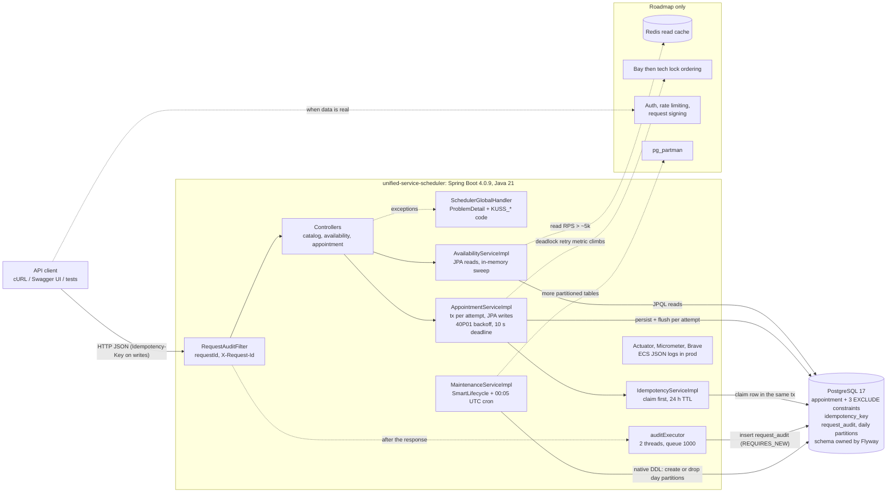
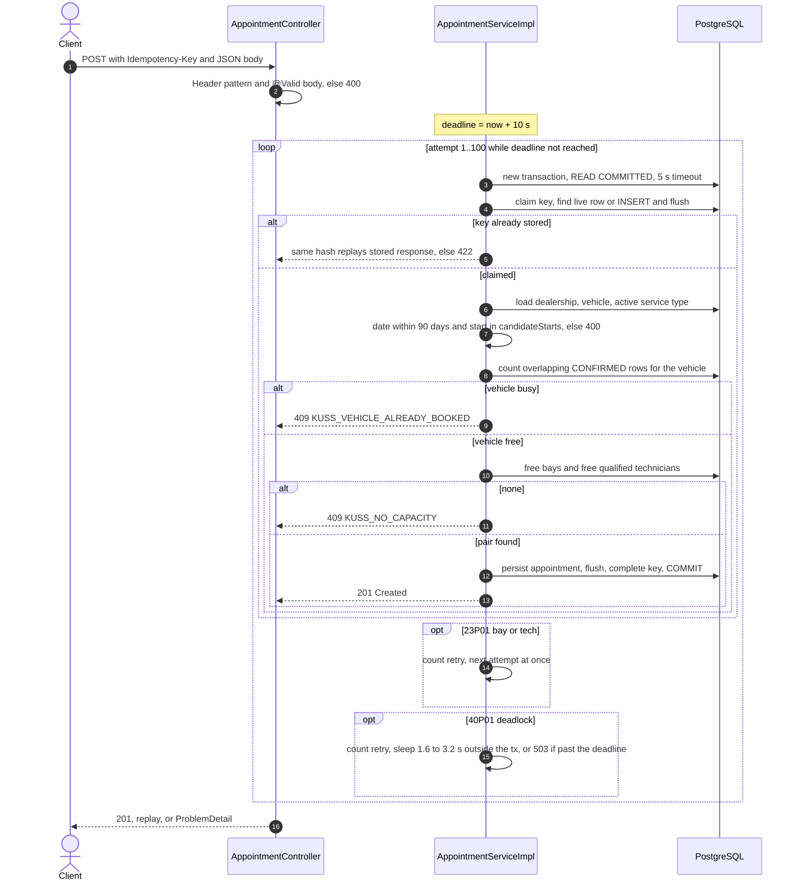

# Unified Service Scheduler — System Design

Keyloop challenge, Scenario A (`KeyloopCodingChallange.pdf`). Backend only: a REST API on PostgreSQL. The client is stubbed with OpenAPI (Swagger UI) and cURL.

**Status:** design approved by the user on 2026-10-30 (A-021), implemented in KUSS-04 (PR #10). This document describes the code in `src/main` at `99d0056`. Sources:

- Approved design: `docs/brainstorm/first-draft-high-level.md` (§12 decisions)
- Plan and execution decisions: `plans/261030-KUSS-02-unified-service-scheduler/plan.md`
- Implementation review: `plans/261030-KUSS-02-unified-service-scheduler/reports/review-261031-kuss04-alignment.md`
- Java conventions: `docs/code-standards.md`
- Visual explainer: `docs/visualization/kuss-design.html`
- Decision trail: `docs/agent-discussion/` (`A-xxx` / `C-xxx`)

Every developer decision is written as **Agent selection → Developer decision (after review, date) — confirms / overrides / adds → Reason**. All of them are collected in §10.

## 1. Scope

The three requirements from the PDF and how the code meets them:

| # |                                        PDF requirement                                         |                                                                                    Implementation                                                                                    |
|---|------------------------------------------------------------------------------------------------|--------------------------------------------------------------------------------------------------------------------------------------------------------------------------------------|
| 1 | Book a service for a vehicle, service type and dealership at a desired time                    | `POST /api/v1/appointments` with an `Idempotency-Key` header and the body `{dealershipId, vehicleId, serviceTypeCode, desiredStartTime}`. The customer comes from the vehicle.       |
| 2 | Before confirming, check that a bay and a qualified technician are free for the whole duration | Free-bay and free-qualified-technician queries over `[start, end)`. Three partial `EXCLUDE USING gist` constraints are the race backstop. `GET …/availability` is the advisory read. |
| 3 | Persist an appointment linking customer, vehicle, technician and bay                           | One `appointment` row with FKs to all four, created `CONFIRMED` in one step (`BookingConcurrencyIT.should_link_customer_vehicle_technician_and_bay_on_the_stored_booking`).          |

**Out of scope for V1:** UI, authN/authZ, rate limiting, payments and holds, admin CRUD (master data is seeded by Flyway `V2`), technician shifts, pagination. See §8 #9 for what "no auth" means in practice.

## 2. Architecture



The app holds no state between requests, so it can run as more than one instance. Correctness never depends on the JVM: overlap rules and idempotency keys live in PostgreSQL.

## 3. Components

### 3.1 Package layout

Root `com.keyloop.scheduler`. Each domain is split by role (conventions #11, `docs/code-standards.md`):

|     Domain     |                                       Subpackages                                        |                                                                                  Holds                                                                                  |
|----------------|------------------------------------------------------------------------------------------|-------------------------------------------------------------------------------------------------------------------------------------------------------------------------|
| `catalog`      | `controller`, `service`, `service/impl`, `repository`, `entity`, `dto`, `mapper`         | Dealerships, service types, customers and vehicles (read only), plus `ServiceBayEntity`/`TechnicianEntity` and their repositories, which availability and booking query |
| `availability` | `controller`, `service`, `service/impl`, `dto`, `mapper`, `util`                         | Free-slot sweep (`AvailabilitySweepUtils`)                                                                                                                              |
| `appointment`  | `controller`, `service`, `service/impl`, `repository`, `entity`, `dto`, `mapper`, `util` | Booking, cancel, idempotency, candidate pick (`CandidateSelectionUtils`), `BookingDeadline`                                                                             |
| `audit`        | `config`, `service`, `service/impl`, `repository`, `entity`, `dto`, `mapper`             | Request audit and the maintenance job                                                                                                                                   |
| `common`       | `constants`, `error`, `util`, `web`                                                      | `*Constants`, `ErrorCode` + `SchedulerGlobalHandler`, `TimeSlotUtils` / `SqlErrorUtils`, `RequestAuditFilter`                                                           |

### 3.2 Roles

|                  Component                  |                                                                                                                                                                                         Role                                                                                                                                                                                          |
|---------------------------------------------|---------------------------------------------------------------------------------------------------------------------------------------------------------------------------------------------------------------------------------------------------------------------------------------------------------------------------------------------------------------------------------------|
| `RequestAuditFilter` (highest precedence)   | Assigns a UUID `requestId`. Puts it in the MDC (`requestId`), the `X-Request-Id` header and a request attribute. After the chain, it hands an audit record to `auditExecutor`. It audits every path except `/actuator/`, `/v3/api-docs` and `/swagger-ui`, matched on the servlet path.                                                                                               |
| Controllers                                 | `CatalogController` (`/api/v1/dealerships`, `/dealerships/{id}`, `/service-types`, `/customers`), `AvailabilityController`, `AppointmentController`. `Idempotency-Key` must match `[A-Za-z0-9_-]{1,128}`. The body is validated with `@Valid` (`serviceTypeCode` ≤ 40 characters, all fields required).                                                                               |
| `SchedulerGlobalHandler`                    | The only `@RestControllerAdvice`. Turns every exception into RFC 9457 `ProblemDetail` with `code` and `requestId`. `detail` is a fixed constant from `ErrorMessageConstants`, or field/parameter messages for validation errors, never a stack trace or SQL. Adds `Retry-After: 1` to `KUSS_SERVICE_BUSY`.                                                                            |
| `AvailabilityServiceImpl`                   | `@Transactional(readOnly = true)` JPQL reads, then `AvailabilitySweepUtils`. Timed by `scheduler.availability.query.duration`.                                                                                                                                                                                                                                                        |
| `AppointmentServiceImpl`                    | Booking retry loop (§4.2), cancel (§4.4), single read and day list.                                                                                                                                                                                                                                                                                                                   |
| `IdempotencyServiceImpl`                    | `claim` / `complete` with `Propagation.MANDATORY`, so both always run inside the caller's attempt transaction (§4.2).                                                                                                                                                                                                                                                                 |
| `RequestAuditServiceImpl` + `auditExecutor` | Fixed pool of 2 threads with a 1000-slot queue. Inserts in `REQUIRES_NEW`. A full queue or a failed write is counted as `failure` and logged at WARN without PII. It never fails a response.                                                                                                                                                                                          |
| `MaintenanceServiceImpl`                    | `SmartLifecycle` at phase `Integer.MIN_VALUE`, so it runs before the web server listens, plus a daily cron at `0 5 0 * * *` UTC. It creates partitions D..D+7, drops those older than 14 days, deletes old rows from `request_audit_default`, and deletes idempotency keys older than 24 h. Each step runs in its own transaction, and a failure is logged without stopping the rest. |
| Flyway                                      | `V1__create_schema.sql` (schema, constraints, partitioned parent) and `V2__insert_seed_data.sql` (2 dealerships, 4 service types, bays, technicians and skills, 3 customers, 24 vehicles).                                                                                                                                                                                            |

### 3.3 Data access: JPA only

- Agent selection: JPA reads + `JdbcClient` writes (plan decision 1, agreed in A-024), so constraint violations reach the code intact and Hibernate cannot mark a transaction rollback-only (A-022).
- **Developer decision (after review, 2026-10-31):** JPA only in `src/main`, no `JdbcClient` — **overrides**:
  - repositories use JPQL `@Query`, with `nativeQuery = true` only where JPQL cannot express it;
  - booking, the idempotency claim and audit writes `persist` + `flush` inside their transaction;
  - cancel is one atomic conditional JPQL `UPDATE` (`status = CONFIRMED` and `start_time > now`), with no explicit locks anywhere;
  - partition DDL runs as `EntityManager` native queries;
  - tests may keep raw JDBC for lock and race harnesses.
- **Reason:** one data-access style, JPQL/`@Query` instead of hand-written JDBC.
- **Why it stays correct:** each booking attempt is a whole transaction that is discarded on failure, so a rollback-only mark costs nothing. `SqlErrorUtils` reads the SQLState and constraint name from the exception's cause chain. The review found 0 `JdbcClient`/`JdbcTemplate` hits in `src/main`.

### 3.4 Data model and schema ownership

|                      Table                      |                                                                            Key points                                                                             |
|-------------------------------------------------|-------------------------------------------------------------------------------------------------------------------------------------------------------------------|
| `dealership`                                    | IANA `timezone`, `open_time`/`close_time`, with `CHECK`s for order and the half-hour grid                                                                         |
| `service_type`                                  | `code` PK (≤ 40 characters), `duration_minutes` `CHECK`ed                                                                                                         |
| `service_bay`, `technician`, `technician_skill` | Per dealership; skills link technicians to service types                                                                                                          |
| `customer`, `vehicle`                           | A vehicle belongs to one customer                                                                                                                                 |
| `appointment`                                   | `start_time`/`end_time` UTC, status `CONFIRMED`/`CANCELLED`, `CHECK`s on time order, status and `cancelled_at`, plus three partial `EXCLUDE` constraints (below)  |
| `idempotency_key`                               | `idempotency_key varchar(128)` PK, `request_hash`, nullable `response_status`/`response_body`, `created_at`                                                       |
| `request_audit`                                 | `PRIMARY KEY (id, occurred_at)`, `PARTITION BY RANGE (occurred_at)`, `request_audit_default` plus day partitions `request_audit_pYYYYMMDD`, BRIN on `occurred_at` |

```sql
CREATE EXTENSION IF NOT EXISTS btree_gist;
-- excl_appointment_bay_overlap / excl_appointment_tech_overlap / excl_appointment_vehicle_overlap
EXCLUDE USING gist (<service_bay_id | technician_id | vehicle_id> WITH =,
                    tstzrange(start_time, end_time, '[)') WITH &&) WHERE (status = 'CONFIRMED')
```

- The `[)` bounds let back-to-back slots coexist.
- The partial `WHERE` means a cancelled row frees its slot and stays as history.
- **The DB enforces overlap only.** Qualification and dealership scope are enforced by the candidate queries (C-005 #1).

**Schema ownership:**

- Agent selection: Flyway `V1`/`V2` + `ddl-auto: validate`.
- **Developer decision (after review, 2026-10-31):** every schema change via Flyway, with `ddl-auto: validate`, `generate-ddl: false`, `clean-disabled: true`, and a committed migration never edited. The only runtime DDL is `MaintenanceServiceImpl` creating and dropping day partitions; it never changes columns, indexes or constraints — **confirms + adds** (A-026).
- **Reason:** one auditable schema history. Daily partitions cannot be versioned migrations.

## 4. Data flow

### 4.1 Availability: `GET /api/v1/dealerships/{id}/availability?date=YYYY-MM-DD&serviceType=CODE`

1. Load the dealership (zone, hours) and the active service type (`404 KUSS_RESOURCE_NOT_FOUND` otherwise).
2. Validate `date` in the dealership zone. A date before today gives `400` "Date is in the past.", and one more than 90 days ahead gives `400` "Date is more than 90 days ahead.".
3. Read the active bays, the active technicians with the skill, and the day's `CONFIRMED` busy intervals.
4. `TimeSlotUtils.candidateStarts`: 30-minute steps from opening where `start + duration ≤ close`, excluding starts before "now" from the injected `Clock`. The same function validates bookings, so reads and writes cannot disagree, including across DST.
5. Each start gets `availableCapacity = min(free bays, free qualified techs)` and is listed when ≥ 1.

The response is `AvailabilityDto {dealershipId, date, serviceTypeCode, timezone, slots: [{startTime (offset of the dealership zone), availableCapacity}]}`. It is advisory, because another booking can take the slot before the POST.

### 4.2 Booking: `POST /api/v1/appointments`



**Idempotency, relative to the retry loop:**

- The key is claimed first in **every** attempt, inside that attempt's transaction, before validation and candidate queries (C-017 Gap 2).
- **Replay and mismatch:**
  - A live row with the same SHA-256 of the canonical request replays the stored status and body.
  - A different hash gives `422 KUSS_IDEMPOTENCY_KEY_MISMATCH`.
  - A row without a response gives `409 KUSS_IDEMPOTENCY_IN_FLIGHT`.
- **The canonical request** is `POST /api/v1/appointments|dealershipId|vehicleId|serviceTypeCode|desiredStartTime as Instant`. Whitespace, field order or an equivalent offset therefore replay instead of returning `422`.
- **Concurrent requests with the same key:** the second claim INSERT blocks on the first's uncommitted row.
  - If the holder commits, the waiter gets `23505` and `409 KUSS_IDEMPOTENCY_IN_FLIGHT`.
  - If the holder rolls back, the claim succeeds.
- **Exact 24 h TTL.** A row older than 24 h is deleted and treated as absent on read, whatever the purge schedule.
  - Agent selection: daily purge only, so keys lived 24–48 h.
  - **Developer decision (after review, 2026-10-31):** expiry checked on read — **adds** (review L-2).
  - **Reason:** the 24 h TTL holds exactly.
- **A failed attempt stores no key**, so a client retry after `409`/`503`/`500` runs fresh.

**The retry loop:**

- **One transaction per attempt** (`TransactionTemplate`, 5 s timeout), and `book()` itself is not transactional. A failed INSERT aborts the PostgreSQL transaction, and a new `READ COMMITTED` snapshot sees the winner's row (C-017 Gap 1).
- **Vehicle first:**
  - Agent selection: the vehicle `EXCLUDE` constraint alone.
  - **Developer decision (after review, 2026-10-31):** `countVehicleOverlaps` runs before capacity, and the constraint stays as the race backstop — **confirms** RT #8.
  - **Reason:** a booked vehicle must get `KUSS_VEHICLE_ALREADY_BOOKED` even when the slot is full.
- **Conflict handling** (`handleConflict`):

  |                           Signal                            |                   Action                   |
  |-------------------------------------------------------------|--------------------------------------------|
  | `excl_appointment_vehicle_overlap`                          | `409` at once                              |
  | `23P01` on the bay or tech constraint                       | Retry at once (counter `bay`/`technician`) |
  | `40P01`                                                     | Back off, then retry (counter `deadlock`)  |
  | Any other SQLState, including the statement timeout `57014` | Rethrown, so `500`                         |

- **Candidate pick:** a random free bay, and the qualified technician with the fewest `CONFIRMED` minutes on that local day (random among ties).

**Deadlocks: root cause and backoff.**

- PostgreSQL checks an exclusion constraint *after* inserting its own index entry, so concurrent conflicting inserts can wait on each other ("unprincipled deadlock", RT #1). `deadlock_timeout=100ms` is set in compose and Testcontainers, and it is a **required database setting for every deployment**: the 1.6–3.2 s backoff below is sized for it.
- **What the storm showed.** PostgreSQL breaks one wait cycle per `deadlock_timeout`. A victim that retries at once re-inserts a conflicting entry and keeps the knot alive, so in a 20-way burst 17–18 inserters stayed blocked in a livelock (plan "Execution and review").
- **`BookingDeadline` backoff:**
  - A deadlock victim sleeps **outside any transaction** for a random wait of **1.6–3.2 s**, then 3.2–6.4 s for its next deadlock (the cap).
  - That is longer than a 20-request knot takes to drain at 100 ms.
  - If the wait would end past the deadline, the request gives up with `503` instead of sleeping.
- **First-wait decision:**
  - Agent selection: the first wait started at `deadlock_timeout` (100–200 ms), and `BookingConcurrencyIT` then failed 3/3 runs with 11–16 requests timing out as `503`.
  - **Developer decision (after review, 2026-10-31):** first wait 1.6–3.2 s, doubling once to the 3.2–6.4 s cap, while keeping the 10 s deadline — **overrides** the 100 ms start.
  - **Reason:** measured 5/5 green with zero `503`s and the slowest burst at 4.8 s. Only burst deadlock losers wait; normal bookings never do.
- **10 s deadline (DD-1):**
  - Agent selection: `MAX_ATTEMPTS = 100`, no total deadline.
  - **Developer decision (after review, 2026-10-31):** a 10 s wall-clock deadline per booking request, checked before each attempt and each sleep. The backoff exponent counts deadlocks only, and nothing sleeps after the last attempt — **adds**.
  - **Reason:** without it, one request could run 10–18 minutes after its client gave up.
  - Worst case is about 10 s plus one 5 s attempt.
- **Lock ordering:**
  - Agent selection: bay → technician `PESSIMISTIC_WRITE` locks before the insert, added by the implementer to stop the storm.
  - **Developer decision (after review, 2026-10-31):** reverted. V1 = `EXCLUDE` + retry, and lock ordering is roadmap (§7) — **overrides**.
  - **Reason:** fix the storm at its root cause (herding and jitter), not with a second locking scheme.

**Overload (DD-2):**

- No free DB connection (`CannotCreateTransactionException`, after Hikari's 3 s `connection-timeout` in prod) or the deadline reached gives `503 KUSS_SERVICE_BUSY` with `Retry-After: 1`. No key is stored, so a same-key retry is safe.
- Agent selection: `500 KUSS_INTERNAL_ERROR` on pool timeout.
- **Developer decision (after review, 2026-10-31):** 503 + `Retry-After` with the new `KUSS_SERVICE_BUSY` — **overrides**. The retry cap (100 attempts) stays `500 KUSS_INTERNAL_ERROR`.
- **Reason:** a 500 reads as a non-retryable server bug; overload is temporary and retryable.

### 4.3 Conflict path (409 / 503)

|                      Cause                      |                                    Detected by                                     |                   Result                    |
|-------------------------------------------------|------------------------------------------------------------------------------------|---------------------------------------------|
| Vehicle already booked in an overlapping window | `countVehicleOverlaps`, or `23P01` on `excl_appointment_vehicle_overlap` in a race | `409 KUSS_VEHICLE_ALREADY_BOOKED`, no retry |
| Bay or technician taken concurrently            | `23P01` on the bay/tech constraint                                                 | Immediate retry on a new snapshot           |
| Concurrent conflicting inserts deadlock         | `40P01`                                                                            | Randomised backoff, then retry              |
| No free bay + qualified technician pair         | Empty candidate query                                                              | `409 KUSS_NO_CAPACITY`                      |
| Same key in flight                              | `23505` on the claim, or a stored row with no response                             | `409 KUSS_IDEMPOTENCY_IN_FLIGHT`            |
| Booking: pool exhausted or 10 s deadline        | `CannotCreateTransactionException` / `BookingDeadline`                             | `503 KUSS_SERVICE_BUSY` + `Retry-After: 1`  |

### 4.4 Cancellation: `POST /api/v1/appointments/{id}/cancel`

One `@Transactional(timeout = 5)` method:

1. Claim the key, with the canonical `POST /api/v1/appointments/{id}/cancel`.
2. `cancelIfConfirmedAndNotStarted`: one conditional JPQL `UPDATE` that sets `CANCELLED` and `cancelled_at` where `status = CONFIRMED` and `start_time > now`. No read locks the row first, and a second canceller waits for the first to commit, matches nothing and sees the cancelled state. Then the appointment is loaded: missing → `404`.
3. **If the update matched nothing and the appointment is still `CONFIRMED`:** its start is at or before now, so `409 KUSS_APPOINTMENT_ALREADY_STARTED`.
4. **Otherwise** (cancelled just now, or already `CANCELLED`): return `200` with its current state, even after its start time.
5. Complete the key with `200` and the body.

The constraints are partial, so the bay and technician are free again at commit.

### 4.5 Request audit and partitions

1. The filter assigns `requestId` and wraps the request (body cache of 4096 bytes).
2. In `finally`, it builds the record: `occurred_at` (µs), method (≤ 10 characters), servlet path (≤ 255), status, `error_code` from the request attribute `kuss_error_code` (set by the handler), duration, and a payload. The payload is kept only for `POST /api/v1/appointments`, whitelisted to its 4 fields. It is null if the body is over 4096 bytes or is not a JSON object.
3. It submits the record to `auditExecutor`. The insert runs in `REQUIRES_NEW` on an audit thread, outside the business transaction, so rolled-back `409`/`500`/`503` calls are recorded too.
4. **Audit scope:**
   - Agent selection: `/api/**`.
   - **Developer decision (after review, 2026-10-31):** every path except actuator and the API docs, on the servlet path, truncated — **overrides** (A-025, RT #10).
   - **Reason:** raw-URI matching can be bypassed with encoded or matrix paths.
5. **Partitions:**
   - PostgreSQL refuses to create a day partition while `request_audit_default` holds rows for that day, so D..D+7 are created before the server listens.
   - Old default rows get a separate `DELETE`.
   - DDL uses `IF [NOT] EXISTS`, so several instances can run the job.

### 4.6 Reads: `GET /api/v1/appointments/{id}` and `GET /api/v1/dealerships/{id}/appointments?date=`

- The day list returns all appointments starting on that local day, cancelled ones included, in start order.
- **Read-date bounds:**
  - Agent selection: availability enforced only the 90-day horizon and answered a past date with `200` and empty slots; the day list had no bound.
  - **Developer decision (after review, 2026-10-31):** availability accepts today .. today + 90 days, and the day list today − 365 .. today + 90 days, in the dealership zone. Outside gives `400 KUSS_VALIDATION_FAILED` — **adds** the bounds, **overrides** the 200 (review L-6, F-7).
  - **Reason:** availability for the past is meaningless, the day list keeps a year of history, and far dates overflowed `timestamptz` and returned 500.

### 4.7 API surface

|                            Endpoint                            |                              Success                               |                  Errors                  |
|----------------------------------------------------------------|--------------------------------------------------------------------|------------------------------------------|
| `GET /api/v1/dealerships`                                      | `200` `[DealershipDto]`                                            | —                                        |
| `GET /api/v1/dealerships/{id}`                                 | `200` `DealershipDetailDto`                                        | `404`                                    |
| `GET /api/v1/service-types`                                    | `200` `[ServiceTypeDto]`                                           | —                                        |
| `GET /api/v1/customers`                                        | `200` `[CustomerDto]`, vehicles as id, make, model, modelYear only | —                                        |
| `GET /api/v1/dealerships/{id}/availability?date=&serviceType=` | `200` `AvailabilityDto`                                            | `400`, `404`                             |
| `GET /api/v1/dealerships/{id}/appointments?date=`              | `200` `[AppointmentDto]`                                           | `400`, `404`                             |
| `POST /api/v1/appointments` + `Idempotency-Key`                | `201` `AppointmentDto` (or the stored replay)                      | `400`, `404`, `409`, `422`, `500`, `503` |
| `GET /api/v1/appointments/{id}`                                | `200` `AppointmentDto`                                             | `404`                                    |
| `POST /api/v1/appointments/{id}/cancel` + `Idempotency-Key`    | `200` `AppointmentDto` (or the replay)                             | `400`, `404`, `409`, `422`, `500`        |

`AppointmentDto` is `{id, dealershipId, customerId, vehicleId, serviceBayId, technicianId, serviceTypeCode, startTime, endTime, status, createdAt, cancelledAt}`, with times as UTC `Instant`. OpenAPI is at `/v3/api-docs`, and Swagger UI at `/swagger-ui.html` (springdoc 3.2.0).

### 4.8 Error catalog (`common/error/ErrorCode`)

Every error is `application/problem+json` with `type`, `title`, `status`, `detail`, `instance`, `code` and `requestId`.

|                Code                | HTTP |                                                                                                                When                                                                                                                 |
|------------------------------------|------|-------------------------------------------------------------------------------------------------------------------------------------------------------------------------------------------------------------------------------------|
| `KUSS_VALIDATION_FAILED`           | 400  | Malformed JSON, a body or parameter constraint, a bad `Idempotency-Key` format, a start not in `candidateStarts`, or a date out of range. Other framework errors (405, 406, 415, …) keep their own status and also carry this code. |
| `KUSS_IDEMPOTENCY_KEY_MISSING`     | 400  | No `Idempotency-Key` on book or cancel                                                                                                                                                                                              |
| `KUSS_RESOURCE_NOT_FOUND`          | 404  | Unknown dealership, vehicle, active service type, appointment, or an unknown path                                                                                                                                                   |
| `KUSS_VEHICLE_ALREADY_BOOKED`      | 409  | Vehicle precheck or the vehicle constraint                                                                                                                                                                                          |
| `KUSS_NO_CAPACITY`                 | 409  | No free bay + qualified technician pair                                                                                                                                                                                             |
| `KUSS_IDEMPOTENCY_IN_FLIGHT`       | 409  | The same key is held by another transaction                                                                                                                                                                                         |
| `KUSS_APPOINTMENT_ALREADY_STARTED` | 409  | Cancel of a confirmed appointment at or after its start                                                                                                                                                                             |
| `KUSS_IDEMPOTENCY_KEY_MISMATCH`    | 422  | Same key, different canonical request                                                                                                                                                                                               |
| `KUSS_SERVICE_BUSY`                | 503  | **Booking only:** pool exhausted or the 10 s booking deadline; sent with `Retry-After: 1`. On cancel and the reads, pool exhaustion falls through to `500 KUSS_INTERNAL_ERROR`.                                                     |
| `KUSS_INTERNAL_ERROR`              | 500  | Unhandled exception, the statement timeout, or the 100-attempt cap. A generic `detail` goes to the client; the stack trace is logged with the `requestId`.                                                                          |

## 5. Technologies

|                               Choice                                |                                                                                                                                                                                       Why                                                                                                                                                                                        |
|---------------------------------------------------------------------|----------------------------------------------------------------------------------------------------------------------------------------------------------------------------------------------------------------------------------------------------------------------------------------------------------------------------------------------------------------------------------|
| Java 21, Spring Boot 4.0.9                                          | The user knows both well. 4.0.9 keeps the verified set: springdoc 3.2.0, Testcontainers 2.x (validation Q2). Virtual threads are on, but the Hikari pool is the real limit: 20 with a 3 s connection timeout in `prod`, 30 in tests, and Hikari's defaults (10, 30 s) in the default profile, so outside `prod` a booking can wait up to 30 s for a connection before its `503`. |
| PostgreSQL 17 + `btree_gist`                                        | `EXCLUDE USING gist` on `tstzrange` enforces "no overlap for the whole duration" in the database: no slot tables, no table or distributed locks (Approach A). It also hosts the idempotency store and the partitioned audit.                                                                                                                                                     |
| Spring Data JPA (Hibernate)                                         | The only data-access style (§3.3)                                                                                                                                                                                                                                                                                                                                                |
| Flyway (`spring-boot-starter-flyway`, `flyway-database-postgresql`) | Schema owner. Bare `flyway-core` silently skips migrations in Boot 4.                                                                                                                                                                                                                                                                                                            |
| springdoc-openapi 3.2.0                                             | The PDF's client stub: a contract plus Swagger UI                                                                                                                                                                                                                                                                                                                                |
| Micrometer + Prometheus registry, Brave tracing bridge              | Metrics and trace ids (§6)                                                                                                                                                                                                                                                                                                                                                       |
| Testcontainers PostgreSQL                                           | H2 has no `EXCLUDE`/gist. One shared container per context, with `deadlock_timeout=100ms`.                                                                                                                                                                                                                                                                                       |
| Docker or Podman                                                    | One standard compose file. Fully qualified images (`docker.io/library/postgres:17`, `docker.io/library/eclipse-temurin:21-jdk` to build and `:21-jre` to run) because Podman resolves short names strictly. Multi-stage `Dockerfile`, non-root user.                                                                                                                             |
| Lombok, MapStruct, Spotless, Checkstyle                             | Conventions: builders, generated mappers, google-java-format (Google style, 2-space), Markdown via flexmark, methods ≤ 20 lines. `./mvnw verify` enforces them.                                                                                                                                                                                                                  |

**Considered and cut:**

- WebSocket: there is no UI.
- RabbitMQ for writes: it would force a `202`.
- Redis locks or holds: TTL drift.
- `PENDING` holds: there is no payment step.
- Slot rows: about 130M mostly empty rows.
- Advisory locks: C-008.
- Savepoints: Hibernate keeps the failed state.
- `JdbcClient`: one data-access style.
- Bay/tech lock ordering in V1: reverted.
- `pg_partman`: roadmap.

## 6. Observability

- **Logs:** human-readable by default, ECS JSON in the `prod` profile (compose runs `prod`). The MDC carries `requestId`, plus `traceId`/`spanId` from the Brave bridge. No PII is logged; the audit drop log has ids, method, path, status and code only.
  - Agent selection: phase 07's criterion "prod JSON log lines carry `traceId`".
  - **Developer decision (after review, 2026-10-31):** the MDC wiring alone is accepted. `traceId`/`spanId` appear on WARN/ERROR lines, with no per-request INFO line — **overrides** the criterion.
  - **Reason:** no per-request log noise.
- **Correlation:** one `requestId` joins the `X-Request-Id` header, the ProblemDetail, log lines and the `request_audit` row.
- **Metrics:** Actuator exposes `health`, `info` and `prometheus` (`/actuator/prometheus`). Domain meters are pre-registered, so they exist before the first event:

  |                  Meter                  |                  Prometheus name                  |                                                                                                                                                              Tags                                                                                                                                                               |
  |-----------------------------------------|---------------------------------------------------|---------------------------------------------------------------------------------------------------------------------------------------------------------------------------------------------------------------------------------------------------------------------------------------------------------------------------------|
  | `scheduler.booking.requests`            | `scheduler_booking_requests_total`                | `result` = `confirmed` or `KUSS_*` (validation, not found, internal, service busy, no capacity, vehicle booked, in flight, mismatch). `service_type` = the request code only for `confirmed`, `KUSS_NO_CAPACITY` and `KUSS_VEHICLE_ALREADY_BOOKED`, else `unknown`, so client input never becomes a free-form tag (review H-1). |
  | `scheduler.booking.gist_retries`        | `scheduler_booking_gist_retries_total`            | `conflict_type` = `bay`, `technician` or `deadlock`. The deadlock series is the trigger for the lock-ordering roadmap item.                                                                                                                                                                                                     |
  | `scheduler.availability.query.duration` | `scheduler_availability_query_duration_seconds_*` | —                                                                                                                                                                                                                                                                                                                               |
  | `scheduler.audit.writes`                | `scheduler_audit_writes_total`                    | `status` = `success` or `failure` (write error or full queue)                                                                                                                                                                                                                                                                   |

  Plus the Boot defaults: JVM, HikariCP (`hikaricp_connections_pending`/`active`), `http_server_requests_seconds`.

  `scheduler.booking.requests` counts what reaches `book()`. A replay counts as `confirmed`. 400s raised before the service (`@Valid`, key pattern, missing key, malformed JSON) are not counted there; they show in `http_server_requests_seconds` and `request_audit`.

- **Health:** `/actuator/health`, with `/liveness` and `/readiness`. Readiness includes `db`.

- **Request audit:** 14 days of every audited request, best effort by design (drops are counted, never blocking).

- **Not in V1:** a trace exporter (OTLP), Prometheus/Grafana containers. Compose runs `db` + `app` only.

## 7. Scalability, roadmap and verification

|                                         Trigger                                         |                                                                                            Change                                                                                            |
|-----------------------------------------------------------------------------------------|----------------------------------------------------------------------------------------------------------------------------------------------------------------------------------------------|
| `scheduler_booking_gist_retries_total{conflict_type="deadlock"}` climbs under real load | **Lock ordering before the insert:** pessimistic locks on the chosen bay, then the technician, so contenders queue instead of deadlocking. Kept out of V1 by the developer decision in §4.2. |
| Availability reads above roughly 5k RPS                                                 | **Redis cache-aside** for availability (short TTL, evicted on book or cancel), plus read replicas. The `EXCLUDE` constraints stay the write authority.                                       |
| Real customer data or partner access                                                    | **Auth** with per-dealership scoping, rate limiting, `GET /customers` pagination.                                                                                                            |
| Partner or public network clients                                                       | **Keyed request signing** (HMAC over method + path + timestamp + SHA-256(body), or RFC 9421) with a replay window. An unkeyed hash is recomputable (A-019).                                  |
| More partitioned tables, or retention managed by DBAs                                   | **`pg_partman`** replaces `MaintenanceServiceImpl`'s partition DDL. Flyway keeps the parent schema.                                                                                          |
| Notifications, DMS sync, cross-region tracing                                           | Transactional outbox → RabbitMQ/Kafka, and an OTLP exporter.                                                                                                                                 |

**Verification.** The test sources hold 36 unit test methods (`*Test`, Surefire) and 76 integration test methods (`*IT`, Failsafe on Testcontainers), counted from `src/test` at `99d0056`:

|            Area            |                                                                           Classes                                                                            |
|----------------------------|--------------------------------------------------------------------------------------------------------------------------------------------------------------|
| Concurrency (release gate) | `BookingConcurrencyIT` (20-way bursts, bay-bound K=3 and tech-bound K=2, exactly K × `201`), `SchemaConstraintsIT` (two-connection race), `VehicleOverlapIT` |
| Idempotency                | `IdempotencyIT` (replay, `422`, in flight, rolled-back claim, TTL)                                                                                           |
| HTTP contract              | `AppointmentApiIT` (every code, HTTP burst N=10/K=3, `/v3/api-docs`), `AvailabilityApiIT`, `CatalogApiIT`, `ErrorHandlingIT`, `SchedulerGlobalHandlerTest`   |
| Time and selection         | `TimeSlotUtilsTest` (grid, DST, zones), `AvailabilitySweepTest`, `CandidateSelectionTest`, `BookingDeadlineTest`, `AppointmentServiceImplTest`               |
| Audit and ops              | `RequestAuditIT`, `RequestAuditFilterTest`, `PartitionMaintenanceIT`, `MetricsIT`, `SchedulerApplicationIT`                                                  |

The last full run recorded in the repo is the KUSS-04 review: `./mvnw -B verify`, BUILD SUCCESS, 35 + 72 tests, before fixes F-1..F-8 added tests. The `BookingConcurrencyIT` gate went 5/5 green after the backoff change (plan "Execution and review").

## 8. Assumptions

1. **Exclusive 1:1.** One bay and one qualified technician per appointment for the whole `[start, end)` (A-006).
2. **Bays and technicians.** Bays are general purpose; technicians have 1..N skills; the system assigns both (A-008).
3. **Grid.** Starts fall on the 30-minute grid in dealership-local time, and durations are multiples of 30 (30/60/90/120 in the seed). `desiredStartTime` is ISO-8601 with an offset.
4. **Hours and horizon.** The whole service fits in that local day's opening hours, starts no earlier than now (`!start.isBefore(now)`), and is at most 90 days ahead.
5. **One booking per vehicle at a time,** across dealerships.
6. **Single-step confirmation:** no payment, no holds.
7. **Seeded master data:** no admin CRUD.
8. **Idempotency keys** are required on book and cancel and valid for exactly 24 h. Failed attempts store none.
9. **No authentication:**
   - Agent selection: "no auth in V1; seeded data is synthetic".
   - **Developer decision (after review, 2026-10-31):** anyone can read all data and cancel any appointment. Auth and per-dealership scoping are roadmap, and there is no rate limiting — **overrides** (A-025, RT #10, #14).
   - **Reason:** don't imply safety that isn't there. `GET /customers` returns no VIN or plate.
   - Compose binds `db` to `127.0.0.1:5432` but publishes `app` on `8080` on all interfaces. Keep the stack on a trusted network.
10. **Audit is best effort,** kept 14 days.
11. **Sizing** (assumptions, not measurements): about 2,000 dealerships, ~60k bookings/day, peaks of ~1,500 read and ~100 write RPS (A-002).

## 9. How GenAI assisted the design phase

Full dated evidence: `docs/ai-collaboration-log.md`.

- **The human wrote first** (`docs/brainstorm/user-draft.md`). Antigravity (Gemini) brainstormed with the user and wrote the draft. It challenged the 500M/month sizing and "one technician, three cars" (A-002, A-005).
- **Claude Code cross-reviewed against primary sources:**
  - `EXCLUDE` checked in the PostgreSQL docs (C-003);
  - an advisory-lock layer rejected (C-008);
  - 10 gaps found in the approved draft, including an unreachable `IN_FLIGHT` path (C-017).
- **Antigravity reviewed the plan back.** It found the Hibernate rollback-only pitfall and the partition start-up window; its Jackson suggestion was rejected with a test (A-022, A-023, C-020).
- **The human decided:**
  - overrode the agents on the Idempotency-Key (A-016);
  - added audit and the `KUSS_*` catalog (A-015, A-017);
  - decided 15 red-team findings one by one, asking for the root cause on deadlocks and partition ownership;
  - corrected the plan's Docker assumption (Podman);
  - added 11 code conventions.
- **During implementation the human stayed the gate:**
  - reverted the implementer's lock ordering;
  - chose JPA-only data access;
  - set the 10 s deadline, the 503 contract and the 1.6 s first backoff from measured runs.

## 10. Decision record

Format: Agent selection → Developer decision (after review, date) — kind → Reason. The code conventions (#1–#11) are in `docs/code-standards.md` "Developer decisions log".

|                 Topic                 |                     Agent selection                      |                                           Developer decision (after review, date) — kind                                            |                              Reason                              |         Ref         |
|---------------------------------------|----------------------------------------------------------|-------------------------------------------------------------------------------------------------------------------------------------|------------------------------------------------------------------|---------------------|
| Concurrency                           | Approach A: partial `EXCLUDE` + retry until no free pair | Approved (2026-10-30) — confirms                                                                                                    | DB invariants, no table locks or slot rows                       | A-018               |
| Idempotency                           | None; the vehicle `EXCLUDE` turns a duplicate into `409` | Required `Idempotency-Key` on book and cancel, same-tx table, 24 h, replay / `422` / `409` (2026-10-30) — overrides                 | A client retrying after a timeout must get the original response | A-016               |
| Request audit                         | None                                                     | Every request, async, daily partitions, BRIN, 14 days (2026-10-30) — adds                                                           | Incident triage without slowing requests                         | A-015               |
| Error handling                        | RFC 9457, no catalog                                     | One handler, `KUSS_*` enum, `requestId`, code in audit (2026-10-30) — adds                                                          | One machine-readable catalog                                     | A-017               |
| Request signing                       | None                                                     | Roadmap with auth (2026-10-30) — adds                                                                                               | An unkeyed hash can be recomputed                                | A-019               |
| POST body, extra endpoints, tech pick | Minimal body; discovery + cancel; fewest minutes         | Approved (2026-10-30) — confirms                                                                                                    | Clean contract, Swagger-testable, fair load                      | A-020               |
| Audit scope                           | `/api/**`                                                | All but actuator and API docs, servlet path, truncated (2026-10-31) — overrides                                                     | Raw-URI matching can be bypassed                                 | A-025, RT #10       |
| No-auth wording                       | "No auth in V1"                                          | State the consequence, no rate limit (2026-10-31) — overrides                                                                       | Don't imply safety                                               | A-025               |
| `GET /customers`                      | Full vehicle rows                                        | id, make, model, modelYear only (2026-10-31) — overrides                                                                            | No VIN or plate in public                                        | A-025               |
| Schema ownership                      | Flyway `V1`/`V2` + `validate`                            | Flyway only; partition job is the sole runtime DDL (2026-10-31) — confirms + adds                                                   | One auditable schema history                                     | A-026               |
| Deadlocks                             | Research: "no cycles"                                    | Retry `40P01`, `deadlock_timeout=100ms` (2026-10-31) — confirms RT #1                                                               | Exclusion inserts deadlock by design                             | RT #1               |
| Vehicle check order                   | Constraint only                                          | `EXISTS` precheck first (2026-10-31) — confirms RT #8                                                                               | Right code when the slot is also full                            | RT #8               |
| Red-team rejection                    | Drop DEFAULT/`response_status`, early-return cancel      | Rejected (2026-10-31) — confirms                                                                                                    | Fixed schema, replay semantics                                   | RT #15              |
| Boot line                             | 4.0.9 as researched                                      | 4.0.9 (2026-10-31) — confirms                                                                                                       | Verified version set                                             | Validation Q2       |
| Container runtime                     | Docker, installed by the user                            | Podman, provisioned by the orchestrator; both `podman compose` and `docker compose` (2026-10-31) — overrides                        | The machine runs Podman                                          | Validation Q1       |
| Phase 07 order                        | "Order is strict"                                        | Split into 7a (audit + maintenance, a parallel Haiku worker, cherry-picked) and 7b (metrics, probes, logs) (2026-10-31) — overrides | 7a has no code dependency on phases 4–6                          | plan, review E-1    |
| Data access                           | JPA reads + `JdbcClient` writes                          | JPA only in `src/main` (2026-10-31) — overrides                                                                                     | One data-access style                                            | conventions #10     |
| Lock ordering                         | Bay → tech locks before insert (implementer, `d536d09`)  | Reverted; roadmap, trigger = deadlock metric (2026-10-31) — overrides                                                               | Fix the root cause (herding/jitter)                              | A-027, review E-2   |
| Booking deadline (DD-1)               | `MAX_ATTEMPTS = 100`, no deadline                        | 10 s per request, deadlock-only exponent, no last sleep (2026-10-31) — adds                                                         | No work after the client gave up                                 | review M-1          |
| First deadlock wait                   | Starts at `deadlock_timeout` (100–200 ms)                | 1.6–3.2 s, doubling once to 3.2–6.4 s (2026-10-31) — overrides                                                                      | 5/5 green, 0 × 503, slowest burst 4.8 s                          | plan                |
| Overload status (DD-2)                | Pool exhausted → `500`                                   | `503` + `Retry-After: 1`, `KUSS_SERVICE_BUSY`; retry cap stays `500` (2026-10-31) — overrides                                       | Overload is retryable; a 500 reads as a bug                      | review L-5          |
| Trace ids                             | `traceId` on prod log lines (criterion)                  | MDC wiring only, no per-request INFO (2026-10-31) — overrides                                                                       | No per-request log noise                                         | plan                |
| Key TTL                               | Daily purge, keys live 24–48 h                           | Expiry checked on read (2026-10-31) — adds                                                                                          | Exact 24 h                                                       | review L-2          |
| Read dates                            | Horizon only / unbounded                                 | Availability today..+90 d, day list −365..+90 d (2026-10-31) — adds + overrides                                                     | Past availability is meaningless; far dates gave 500             | review L-6, F-7     |
| Java style                            | AOSP (4-space), chosen by the implementer                | Google style, 2-space (2026-10-31) — overrides                                                                                      | Keep the documented format                                       | `code-standards.md` |
| Markdown formatting                   | Implementer dropped the Markdown step from Spotless      | Markdown stays in `verify`; the docs owner runs `spotless:apply` after each edit (2026-10-31) — confirms                            | An agent formatted another agent's files                         | conventions #6      |

